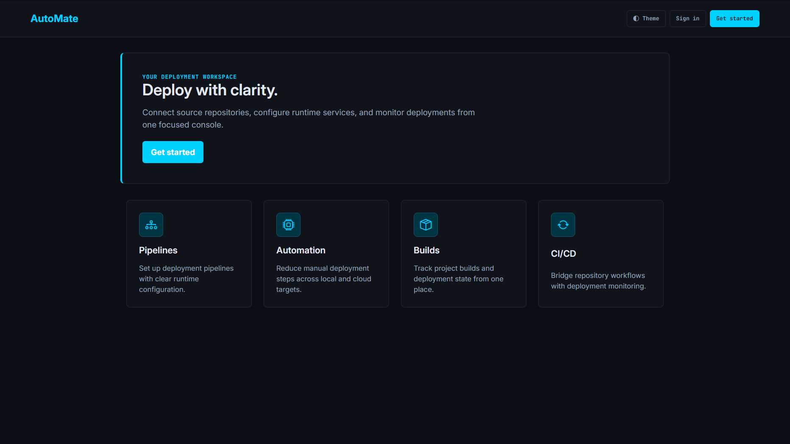
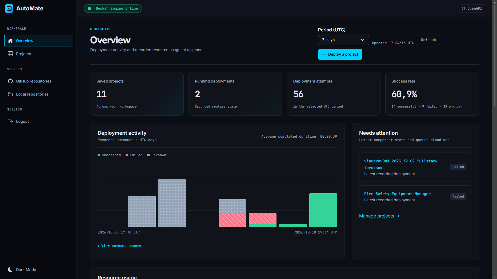
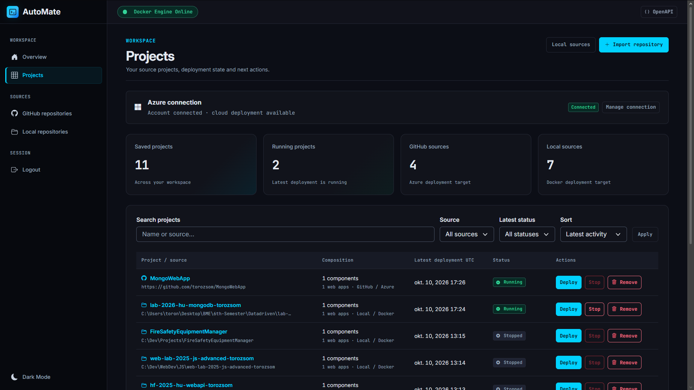
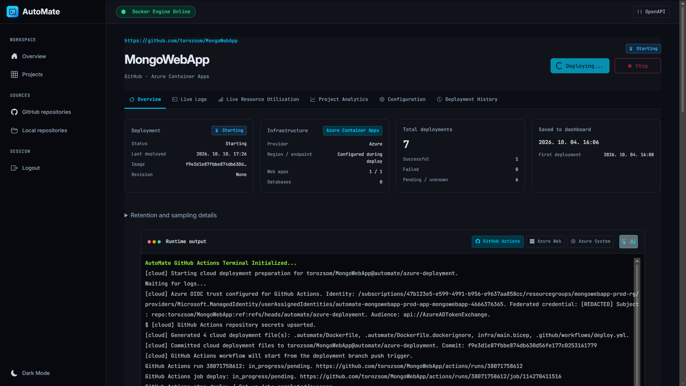
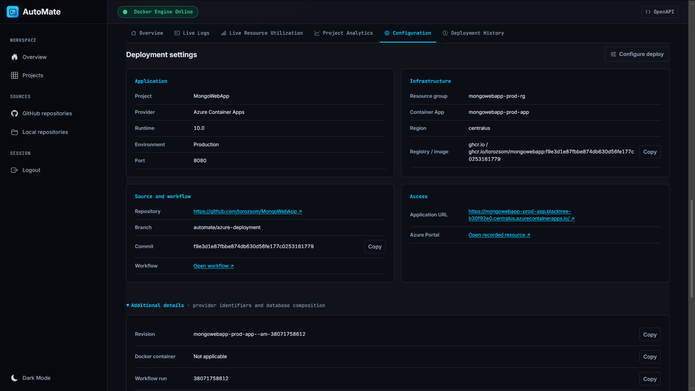
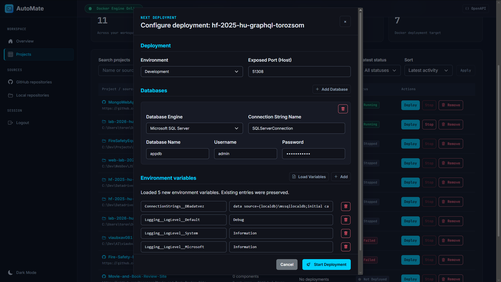

<div align="center">
  <h1>AutoMate</h1>
  <p><b>A self-hosted deployment companion for .NET projects, from source discovery to Docker and Azure Container Apps delivery.</b></p>

  
  
  
  
  
  
</div>

---

## Overview

AutoMate helps developers automate the operational work between "the source code is ready" and "the application is deployed".

It can discover local and GitHub-hosted .NET projects, prepare deployment configuration, generate infrastructure/deployment artifacts from templates, run local Docker Compose deployments, and orchestrate cloud deployments through GitHub Actions and Azure Container Apps.

The application uses the following architectural layers. EF-backed application-service implementations currently
live in Infrastructure, as documented in the navigation map:

| Project | Responsibility |
|---|---|
| [`Domain`](./Domain/README.md) | Framework-neutral entities, DTOs, enums, defaults, and shared contracts |
| [`Application`](./Application/README.md) | Application contracts, orchestration interfaces, queues, and outbound ports |
| [`Infrastructure`](./Infrastructure/README.md) | EF Core, migrations, scanning, templating, Docker, GitHub, Azure, and email adapters |
| [`Web`](./Web/README.md) | Blazor Server UI, Minimal API endpoints, SignalR hubs, startup, and HTTP pipeline |

---

## Screenshots

<div align="center">
  
  <br><br>
  
  <br><br>
  
  <br><br>
  
  <br><br>
  
  <br><br>
  
  <br><br>
</div>

---

## Key Features

- Local account registration with email verification
- GitHub OAuth sign-in and repository import
- Azure account connection through Microsoft Entra OAuth
- Local filesystem scanning for Git repositories, `.sln`, `.slnx`, and `.csproj` files
- GitHub repository discovery and C# project registration
- Project dependency analysis for web projects and database providers
- Deployment configuration UI for environments, ports, databases, and environment variables
- Scriban-based artifact generation from a template manifest
- Local Docker Compose deployment for local projects
- GitHub Actions workflow generation for cloud deployments
- GitHub Container Registry image publishing
- Azure OIDC federation setup for GitHub Actions
- Azure Container Apps deployment with managed environment and Log Analytics
- Real-time build logs, container logs, and metrics through SignalR and xterm.js
- Deployment status persistence and live UI status updates
- Startup cleanup hosted service to reconcile persisted deployments with actual runtime state

---

## Deployment Workflows

### Local development hosting

Run AutoMate through `deploy/infrastructure`, `deploy/telemetry` and `deploy/app`, each with `docker compose up -d`.
The [local setup guide](deploy/README.md) describes the startup order and private settings. Both ASP.NET hosts run in
Development mode; the internal `SelfHosted` capability setting enables local filesystem discovery and Docker deployment.

`/health` provides lightweight liveness; `/health/ready` checks AI configuration and durable queue readiness.
See [probe status codes and scope](Web/Configs/README.md).

The [AI analysis and security monitoring guide](docs/ai-analysis-operations.md) defines operator dashboard signals,
read-only backlog queries, initial alert conditions and incident responses. Collector/backends and alert routing are
operator-configured; the guide does not enable AI or provision a monitoring stack.

AI controls share quota/rate allowances across an owner's projects and reserve conservative cost before provider
attempts under cluster-wide concurrency guards. Currency defaults to USD and spending defaults to zero. See
[operator limits, budget configuration and migration](Infrastructure/Ai/README.md).

The [staged rollout and shutdown procedure](docs/ai-analysis-operations.md#staged-feature-enablement-and-shutdown)
uses the default-off flags and approved owner cohort. Reloading AI policy cancels active OpenAI HTTP work locally;
all replicas must observe the change, and already-sent remote processing cannot be recalled. Deployment work continues.

### Local Docker Workflow

1. The user selects a local project from the dashboard.
2. AutoMate analyzes the `.csproj` graph and inferred dependencies.
3. The user confirms deployment configuration in `ConfigurationForm`.
4. Scriban templates generate Docker artifacts into `.automate/`.
5. AutoMate runs Docker Compose.
6. Build logs, container logs, and metrics stream to the project details page.
7. Deployment state is persisted in PostgreSQL and broadcast to open UI sessions.

Generated local artifacts include:

- `Dockerfile`
- `Dockerfile.dockerignore`
- `docker-compose.yml`

### Azure Container Apps Workflow

1. The user imports a GitHub repository and connects Azure.
2. AutoMate creates or updates a user-assigned managed identity in Azure.
3. AutoMate registers required Azure resource providers:
   - `Microsoft.App`
   - `Microsoft.OperationalInsights`
4. AutoMate configures GitHub Actions OIDC federation on the managed identity.
5. AutoMate upserts GitHub repository secrets:
   - `AZURE_CLIENT_ID`
   - `AZURE_TENANT_ID`
   - `AZURE_SUBSCRIPTION_ID`
   - `GHCR_PAT`
6. AutoMate generates cloud deployment files and commits them to `automate/azure-deployment`.
7. GitHub Actions builds the Docker image and pushes it to GHCR.
8. GitHub Actions authenticates to Azure with OIDC.
9. Bicep deploys:
   - Azure Container App
   - Container Apps managed environment
   - Log Analytics workspace
10. The application becomes available at the generated Azure Container Apps URL.

Generated cloud artifacts include:

- `.automate/Dockerfile`
- `.automate/Dockerfile.dockerignore`
- `infra/main.bicep`
- `.github/workflows/deploy.yml`

---

## Architecture and Design Patterns

AutoMate intentionally keeps infrastructure and UI concerns out of the domain model.

- **Clean Architecture:** `Domain` has no dependency on `Application`, `Infrastructure`, or `Web`.
- **Dependency Injection:** infrastructure boundaries use Application ports; focused workflow and presentation collaborators
  use explicit dependencies at the composition root.
- **Minimal API endpoint modules:** endpoint classes implement `IEndpoint`; raw route definitions stay out of `Program.cs`.
- **Thin startup:** `Program.cs` delegates service registration and pipeline setup to configuration extensions.
- **Template-driven deployment:** deployment files are rendered from Scriban templates and a manifest.
- **Hosted service lifecycle:** background cleanup uses `IHostedService`, not manual timer threads.
- **SignalR real-time streaming:** logs and metrics are pushed to project-scoped client groups.
- **EF Core TPH inheritance:** local and remote users share the `User` model hierarchy.
- **Data Protection for secrets:** provider access tokens are encrypted before persistence.
- **OAuth and OIDC:** GitHub OAuth for source access, Microsoft OAuth for Azure connection, GitHub Actions OIDC for Azure deployment.
- **Resource ownership boundaries:** generated deployment assets live in target repositories, while AutoMate stores only orchestration metadata.

---

## Tech Stack

| Area | Technology |
|---|---|
| Runtime | .NET 10, ASP.NET Core |
| UI | Blazor Server, Bootstrap 5, Bootstrap Icons |
| Real time | SignalR, xterm.js |
| Persistence | PostgreSQL, Entity Framework Core |
| Cache | Redis distributed cache |
| Local runtime | Docker Engine, Docker Compose |
| Cloud runtime | Azure Container Apps |
| Cloud IaC | Bicep |
| CI/CD | GitHub Actions |
| Registry | GitHub Container Registry |
| Auth | Cookie auth, GitHub OAuth, Microsoft Entra OAuth, GitHub OIDC |
| Templates | Scriban |

---

## Getting Started

### Prerequisites

- [.NET SDK 10.0+](https://dotnet.microsoft.com/download)
- Docker Desktop or Docker Engine with Docker Compose
- PostgreSQL and Redis, or the provided Docker Compose infrastructure
- GitHub OAuth app for GitHub sign-in/repository access
- Microsoft Entra app registration for Azure connection
- Azure subscription for cloud deployments

### Start the local stack

The three folder-local `.env` files contain private configuration. On a new machine, follow
[the initial setup instructions](deploy/README.md). With Docker Desktop running in Linux-container mode:

```powershell
cd deploy/infrastructure
docker compose up -d
cd ../telemetry
docker compose up -d
cd ../app
docker compose up -d
```

Open [AutoMate](http://localhost:8080). The app stack builds both ASP.NET hosts and waits for its dependencies.
Web applies checked-in migrations automatically. After source changes, run `docker compose up -d --build` in
`deploy/app`. Stop the stacks with `docker compose down` in reverse order. Named volumes retain local data.

OAuth credentials belong in `deploy/app/.env`; do not commit credentials to application settings. The image build
excludes private environment and telemetry credential files.

---

## OAuth and Cloud Setup

### GitHub OAuth

The GitHub OAuth app should allow repository and workflow access. AutoMate requests scopes for:

- user email
- repository access
- workflow access
- package read/write access

### Microsoft Entra OAuth

Use a Web platform app registration with redirect URI:

```text
https://localhost:<port>/signin-microsoft
```

For multi-tenant Azure connection, configure supported account types for organizational accounts and use `organizations` or no explicit tenant setting.

Required delegated permissions include Azure Resource Manager access (`user_impersonation`) plus standard OpenID Connect scopes.

### Azure Permissions

The connected Azure user must be able to:

- create resource groups
- create user-assigned managed identities
- create federated identity credentials
- assign Contributor to the deployment identity
- register required resource providers at subscription scope, or have them pre-registered

In practice, `Owner` on the target subscription/resource group is the simplest development setup.

---

## Developer Workflows

### Add a Migration

```bash
cd Web
dotnet ef migrations add <MigrationName> --project ../Infrastructure
dotnet ef database update --project ../Infrastructure
```

### Build the Solution

```bash
dotnet build AutoMate.slnx
```

### Run Infrastructure Only

```bash
cd deploy/infrastructure
docker compose up -d
```

### Stop Infrastructure

```bash
cd deploy/infrastructure
docker compose down
```

---

## Repository Notes

- `Program.cs` is intentionally minimal.
- Add Minimal API routes through `Web/Routes/Endpoints/` and register with endpoint discovery.
- Add deployment templates through `Infrastructure/Templating/Templates/` and `template-manifest.json`.
- Keep domain contracts in `Domain` independent from infrastructure and UI.
- Prefer hosted services for lifecycle/background work.
- Never commit OAuth secrets, app passwords, PATs, or connection-string passwords.

---

## Status

AutoMate currently supports:

- local Docker deployment for local .NET web projects
- GitHub repository import
- Azure connection through Microsoft Entra
- GitHub Actions based Azure Container Apps deployment
- live workflow/build/runtime log streaming

Future improvements may include richer Azure subscription selection and broader cloud target support. Deployment
history and AI cost controls are implemented as described below.

## Deployment history storage

Both hosting profiles require the private disk gateway with Loki for new deployment logs and Mimir for numeric samples.
PostgreSQL retains metadata and legacy reads/draining; new payload writes and a database fallback are rejected.
Runtime collection requires background owner opt-in or authorized active viewing. See
[configuration, quotas and the self-managed pilot](docs/deployment-telemetry.md).

### AI deployment diagnostics

Both profiles implement owner-authorized manual analysis and globally opt-in automatic failure analysis through a
durable leased queue. The project page exposes exact-project consent, request/refresh and cancellation, safe state
guidance and validated results; advice is never executed. Active work can be canceled and terminal results deleted
through the owner-authorized API. Context stays in memory; validated guidance and control metadata use PostgreSQL.

AI/automatic/provider flags remain off by default, with an explicit approved-owner cohort and fresh project consent.
Currency defaults to USD and provider spending to zero. Work execution expires after configurable 1–90 days, default
ninety; saved analyses retain until owner deletion under ADR 0004. Independent quota/idempotency receipts and budget
metadata preserve usage through deletion. Leases, durable retries,
shared capacity/budgets and reload shutdown guard execution without blocking deployment work.

See [architecture, onboarding and ordered metadata upgrades](docs/ai-analysis.md),
[monitoring and shutdown](docs/ai-analysis-operations.md), [pilot acceptance](docs/ai-analysis-rollout.md) and
[implementation decisions](docs/adr/0003-ai-analysis-execution-and-rollout.md). Provider/account/model/region approvals,
live migration application and an internal pilot remain pending; [AI rollout record](docs/ai-analysis-rollout.md) tracks those gates.
The [owned PostgreSQL verification runner](deploy/verification/README.md) tests migrations/shared locks without using
an application database. [Azure OpenAI preparation](docs/azure-openai-integration-plan.md) records the requested next
adapter and remaining resource/identity/deployment inputs; Azure egress is not enabled.

AutoMate's platform OpenTelemetry logs now include fixed security/analysis audit events, GUID correlation scopes and
uniform service/environment/version/hosting-profile resources. See [platform observability](Application/Diagnostics/README.md)
for coverage and supported export/redaction boundaries. Deployment log/metric persistence continues through Loki/Mimir.

## Engineering verification

The [refinement record](docs/engineering-refinement.md) describes the behavior-preserving boundaries and excluded
behavioral changes. [CI - Build and test](.github/workflows/verify.yml) checks pull requests targeting `main`, with
separate jobs for a warning-free Release build/.NET tests, JavaScript behavior tests, browser verification and source
hygiene. The .NET job publishes rendered fixtures for the browser job, avoiding a second build. TRX results and
browser screenshots are retained as workflow artifacts. The console layout audit remains advisory for its known
200% zoom baseline; see [browser verification](Test/Web/Browser/README.md).
Rider's built-in formatter owns C# code layout. Pull requests use `git diff --check` on changed C# lines to reject
trailing whitespace and added blank lines at EOF, accepting both LF and CRLF line endings. CI does not impose
`dotnet format` indentation or wrapping on Rider-formatted code. `.editorconfig` and Directory.Build.props provide
local formatting and .NET analyzer policy without repository-wide reformatting. SDK compatibility remains unchanged.
External PostgreSQL checks use the owned disposable verification
runners; they never use the application database.

### Pipeline responsibilities and triggers

| Pipeline | Pull request to main | Push to main | Scheduled | Manual | Responsibility |
|---|---|---|---|---|---|
| [CI - Build and test](.github/workflows/verify.yml) | Yes, including updated commits | No | No | Yes | Release build, .NET/JS/browser tests, whitespace and aggregate CI gate |
| [Security - CodeQL](.github/workflows/codeql.yml) | Yes | Yes | Monday 04:17 UTC | Yes | Extended C#, JavaScript/TypeScript and Actions security analysis |
| [Security - Dependency review](.github/workflows/dependency-review.yml) | Yes | No | No | No | Reject introduced high/critical vulnerable dependencies |
| [Quality - Qodana](.github/workflows/qodana_code_quality.yml) | Internal PRs | Yes | Monday 04:47 UTC | Yes | Full-solution Community quality reports and scanning baseline |

Ordinary feature-branch pushes do not duplicate PR pipelines. PR jobs rerun on new commits and reopened PRs, rather
than only when a PR is first created. Superseded runs are cancelled within each workflow. CI tests GitHub's PR merge
commit; Qodana intentionally checks the PR head revision. After merging, only security/quality baseline scans run.
CodeQL's C# job still compiles the solution to capture generated Blazor code, but does not repeat the test suite.
Scheduled scans use the default branch and detect findings from updated analysis rules even without source changes.

CodeQL uses the `security-extended` query suite and separate language jobs. Its C# job initializes CodeQL before a
clean .NET 10 Release build, including source generators. The security gate checks scanner execution; the main
ruleset's CodeQL finding thresholds enforce vulnerability policy. Qodana findings remain report-only.

### GitHub activation and merge requirements

Commit the workflow files and `.github/dependabot.yml`; Dependabot reads its configuration from the default branch.
Repository settings are separate from these versioned files:

1. Switch **Settings > Advanced Security > CodeQL analysis** from default to advanced setup before using the custom
   CodeQL workflow. Default setup blocks custom CodeQL uploads. Rerun the PR's CodeQL workflow after switching,
   verify all three languages, then merge and verify the new `main` baseline. See
   [GitHub's migration instructions](https://docs.github.com/en/code-security/how-tos/find-and-fix-code-vulnerabilities/configure-code-scanning/configuring-advanced-setup-for-code-scanning).
2. Keep the dependency graph and Dependabot alerts enabled; enable **Dependabot security updates** in Advanced Security.
   YAML grouping does not turn on that repository setting. No automatic PR merging is configured.
3. After the new jobs have run successfully, add these required checks to the main branch ruleset:
   **CI: Required checks**, **CodeQL: Required checks**, **Dependencies: Vulnerability review**, and
   **Qodana: Full solution**. Retain the existing CodeQL high/critical-security and error-level finding policy.
   Qodana's job is skipped for fork PRs and GitHub treats that skip as successful; CI, CodeQL and dependency review
   still cover fork contributions. Keep any separate GitHub Code Quality requirement only with that service enabled;
   it is not satisfied by Qodana or by the security-only CodeQL workflow.
4. Require PRs and **Require branches to be up to date before merging**. With PR-only build/tests, this prevents
   an older successful run from authorizing a merge against an untested newer base. Do not add workflow-level path
   filters to required pipelines, because missing checks can block merging indefinitely.

The existing owner/admin bypass remains a deliberate exception: direct pushes to `main` run security/quality scans
but do not run CI. Use PRs for ordinary owner changes too, or manually dispatch CI for an emergency direct push.
Ruleset changes, enabling security updates, and switching off CodeQL default setup are not applied by editing YAML.
No image publishing or deployment is attached to PR validation; the existing local-only release workflow is not
activated by these changes.

### Dependabot maintenance

[Dependabot configuration](.github/dependabot.yml) checks all six NuGet project directories, the browser-test npm
manifest, Actions references, the tracked Telemetry Dockerfile, deployment Compose files, and the root .NET SDK
configuration on staggered Monday schedules in `Europe/Budapest`. NuGet EF Core and OpenTelemetry maintenance updates
are grouped to keep related packages coordinated; other minor/patch updates are grouped per ecosystem and major
updates receive separate PRs. .NET SDK major updates are excluded so a runtime upgrade remains a deliberate change.
NuGet/npm security updates have separate groups and remain vulnerability-triggered, independent of weekly version
update schedules. PR limits bound routine update volume. Add the root Dockerfile to monitoring when it is versioned.

Dependency review checks GitHub's dependency-graph diff; it does not replace a container-image vulnerability scanner
or identify vulnerabilities in manually vendored browser assets. No arbitrary license policy is enforced. See
[Dependabot options](https://docs.github.com/en/code-security/reference/supply-chain-security/dependabot-options-reference).

## Qodana code quality

[Qodana Community for .NET](https://www.jetbrains.com/help/qodana/dotnet.html) scans all six projects in
`AutoMate.slnx`, including tests, using the Release configuration and `qodana.recommended` profile in
[`qodana.yaml`](qodana.yaml). Generated build outputs and vendored browser libraries are excluded. Community restores
and builds the solution inside its container before analysis; a separate host build is unnecessary.

### GitHub Actions

The [Qodana workflow](.github/workflows/qodana_code_quality.yml) runs manually, weekly, on pushes to `main`, and
on internal pull requests targeting `main`. Fork pull requests are skipped because they cannot access the Cloud
project token. Every scan analyzes the full solution; changed-file-only mode and automatic fixes are disabled.

Set the repository secret `QODANA_TOKEN_245602675` to the existing Qodana Cloud project token. The workflow supplies it
as `QODANA_TOKEN` and publishes to `https://qodana.cloud`. It checks that the secret is present without logging its value.
Results appear in Qodana Cloud, GitHub check annotations, internal PR summary comments, the `qodana-report` workflow
artifact, and GitHub's **Security > Code scanning** view under the `qodana` category. SARIF upload is attempted even
after a scan failure when a report exists; it does not clear the original failure.

Dependabot PRs run Community without a Cloud token, PR comments or check annotations, retaining the result artifact
and SARIF upload. This avoids requiring Actions secrets or write-dependent reporting on Dependabot events. The
Cloud token presence check still applies to ordinary trusted runs. No `pull_request_target` workflow executes PR code.

The scanner has no finding thresholds or baseline configured, and the workflow does not change branch protection.
GitHub evaluates uploaded SARIF separately: its `QDNETC` code-scanning check can fail on new PR alerts according to
repository severity settings even when `Qodana: Full solution` succeeds. Correct those alerts without suppressing
findings or lowering the check's severity threshold. See [GitHub's code-scanning check guidance](https://docs.github.com/en/code-security/how-tos/manage-security-alerts/manage-code-scanning-alerts/triage-alerts-in-pull-requests).
Restore/build, scanner, authentication, and upload failures remain workflow failures. On the first CI run,
verify Cloud publication, artifact availability, annotations and Code scanning ingestion; verify the summary comment
on the first internal PR run. CI - Build and test owns tests and build enforcement.

### Rider and local scans

1. Install or enable Rider's Qodana integration and start Docker Desktop with Linux containers. Use Qodana Community
   for .NET version **2026.2** to match CI; allocate at least 6 GB of Docker memory for analysis.
2. Open AutoMate in Rider and choose **Tools > Qodana > Try Code Analysis with Qodana** (or **Problems > Qodana >
   Try Locally**, depending on the IDE version). Use the repository-root `qodana.yaml`, Community linter and Docker mode.
3. Run the scan and inspect findings in the Qodana tool window. Community can run locally without a Cloud token.
   To upload a local report, supply the project token through the IDE's credential UI or the `QODANA_TOKEN` environment
   variable; never save it in YAML, scripts, documentation, or shared Rider settings.
4. To inspect CI results, sign in to Qodana Cloud from Rider's Qodana tool window, link the existing AutoMate project,
   and enable **Always load most relevant Qodana report**. This prefers a report matching the checked-out revision.
   To inspect a downloaded `qodana-report` artifact, extract it and use **Open Local Report** in the Qodana tool window
   to select its `qodana.sarif.json` report.

Alternatively, with the Qodana CLI installed, run this from the repository root to match CI:

```powershell
qodana scan --image jetbrains/qodana-cdnet:2026.2 --results-dir .qodana/results
qodana show --results-dir .qodana/results
```

Keep analyzer findings visible: do not add source-level message suppressions, warning pragmas or vendor-specific
usage annotations to clear reports. Preserve public/serialized contracts and meaningful fixture lifetimes; when a
behavior-preserving correction is not appropriate, retain the finding and report the reason. Interactive Blazor tests
use bUnit public APIs for component lifecycle, events and markup assertions; static-output tests use HtmlRenderer.
Keep tests independent of Microsoft.AspNetCore.Components.RenderTree implementation APIs so the warnings-as-errors
build remains meaningful.

`qodana.yaml` configures Qodana runs, not Rider's regular editor inspections. Continue to manage editor inspection
severities and formatting through `.editorconfig` and the solution's team-shared `.DotSettings` layer; keep personal
`.DotSettings.user` settings private. InspectCode also consumes applicable shared inspection settings, but IDE and CI
results can differ because of their available inspections and plugins.

Community provides ReSharper-based .NET analysis with narrower Blazor/Razor and frontend coverage than the Rider-based
Ultimate linter. It does not provide JavaScript/TypeScript analysis, license audit, coverage reporting, or automatic
fixes. If an Ultimate license becomes available, switch to `qodana-dotnet`, configure native mode with a .NET 10 SDK and
a pre-analysis restore/build, and reassess those additional features before enabling them. See JetBrains'
[IDE guide](https://www.jetbrains.com/help/qodana/qodana-ide-plugin.html),
[configuration reference](https://www.jetbrains.com/help/qodana/configuration-reference.html), and
[GitHub integration guide](https://www.jetbrains.com/help/qodana/github.html).

## Test organization

[Test](Test/README.md) is the solution's single .NET test project, organized into Infra, App and Web modules with
business submodules. Run `dotnet test Test/Test.csproj` from the repository root.
The root `docs/` directory is local-only and ignored by Git; project and module READMEs remain versioned.
